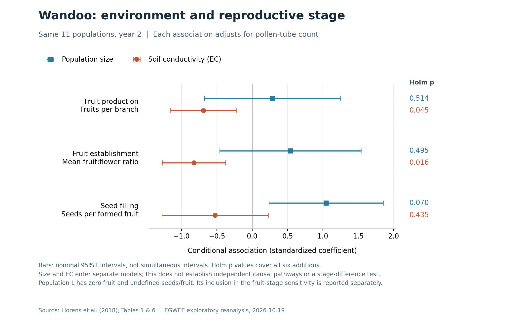

# Wandoo reproductive stages: environmental information beyond pollen-tube quantity

**Date:** 2026-10-19. **Status:** fixed retrospective extension of the Wandoo evidence, based on EGWEE PR 52 head `5a6754d2ca4053d8ecce54f57c28e965ea015fec` and the published population tables of Llorens et al. (2018). The analysis design was recorded before fitting these conditional stage models, but after the source conclusions and earlier EGWEE results were known. It is not an outcome-blind preregistration.

On the same 11 fruit-producing populations, soil electrical conductivity (EC) adds information about year-2 fruit production and fruit:flower ratio beyond the same pollen-tube measure. Both conditional EC associations are negative and pass the six-test Holm correction. Population size adds a positive association with seeds per fruit at the nominal level, but its Holm-adjusted p is 0.06988. The results therefore support an environmental association beyond pollen-tube quantity at the fruit stages; they leave a difference between the drivers of fruit establishment and seed filling provisional. They do not identify distinct causal pathways or a general mechanism of interaction–function mismatch.

## 1. Question, existing evidence, and the added comparison

Llorens et al. (2018), *Altered Soil Properties Inhibit Fruit Set but Increase Progeny Performance for a Foundation Tree in a Highly Fragmented Landscape*, already reported negative soil-salinity associations with fruit production and fruit set, a positive population-size association with year-2 seeds per fruit, and further soil associations with progeny performance. Their analyses included comparisons of soil variables and models containing both EC and population size. Those biological observations are prior evidence, not discoveries of this extension. See the [original article](https://www.frontiersin.org/journals/ecology-and-evolution/articles/10.3389/fevo.2018.00039/full), especially Tables 1, 4, and 6 and the reproduction results; the [original PDF](https://www.frontiersin.org/journals/ecology-and-evolution/articles/10.3389/fevo.2018.00039/pdf) places Tables 1 and 6 on printed pages 4 and 9.

The additional EGWEE question is narrower: **after conditioning on the same observed pollen-tube quantity, does adding population size or EC give similar information at successive reproductive stages?** The three responses are fruit production per branch, the published mean fruit:flower ratio, and seeds per existing fruit. They measure different portions of reproductive performance. They are neither interchangeable estimates of lifetime fitness nor independent biological replications: fruit production and fruit:flower ratio share a fruit component, and all three come from the same populations.

This comparison extends the existing Wandoo contrast between pollen quantity and seed filling with identifiable environmental variables. It does not replace the registered cross-system analysis, add a new independent study, or establish that salinity causes the full I–F contrast.

## 2. Source reconstruction and analysis populations

All 19 Table 1 populations and all 19 Table 6 rows were restored. The source snapshot retains the table text obtained separately from the HTML article and PDF text layer. The input CSVs are generated by parsing that snapshot; numeric CSV cells are not manually retyped. Every available mean, SE, source N, and source year label is retained, including the seven populations without reproductive measurements. EC is recorded in mS/m, population size is the source population count, and isolation and shape retain their original definitions. Isolation is the inverse of the percentage of remnant vegetation within 3 km; shape is the Patton diversity index. EC is a soil-salinity proxy. Population size is not a measurement of population density. [Source: Tables 1 and 6 and methods in the original article.](https://www.frontiersin.org/journals/ecology-and-evolution/articles/10.3389/fevo.2018.00039/full)

| Quantity | Source and scale | Role here |
|---|---|---|
| I: pollen tubes at the base of the style | Table 6, published mean and SE, y2 | Common observed interaction predictor; raw scale |
| Fruits per branch | Table 6, published mean and SE, y2 and y3 | y2 primary response; y3 descriptive context |
| Fruit:flower ratio | Table 6, published mean and SE, y2 | Primary response; used as published, not recalculated from two population means |
| Seeds per fruit | Table 6, published mean and SE, y1 and y2 | y2 primary response among fruit-producing populations; y1 descriptive context |
| Population size | Table 1 | Prespecified log10 covariate |
| Soil EC | Table 1, mS/m | Prespecified log10 covariate |
| Isolation, shape, weeds, pH, N, P, K, organic C, remnant type | Table 1 | Preserved for provenance; no additional outcome models in this extension |

The primary **common11** frame consists of `J,K,F,C,E,G,B,I,A,H,D`. Each has y2 pollen tubes and all three y2 reproductive responses. The sampling unit is population: n = 11, not the number of maternal plants, flowers, fruits, or soil quadrats.

The required **native12** sensitivity adds population `L` for the two fruit responses. L has pollen-tube mean 6.7 (SE 2.6; source pollen N = 4), y2 and y3 fruit production of zero, and fruit:flower ratio zero. Its seeds-per-fruit entries are undefined because it produced no fruits; they remain blank. The source reproductive N for L is 3. Zero-imputing seeds per fruit would change the endpoint and is prohibited. The other seven populations, `S,O,R,N,Q,M,P`, have no reproduction measurements owing to source logistical constraints and remain unmeasured rows.

Consequently, common11 conditions the stage comparison on fruit establishment. This is necessary for the seeds-per-fruit endpoint, but changes the population frame: L also has the highest EC, 50 mS/m, whereas common11 ranges from 4 to 18 mS/m. Results including L must accompany conclusions about fruit production. They are a sensitivity within the same study, not independent confirmation.

Source N is retained as reported in the single Table 6 reproductive N column, not treated as a guarantee of identical effective N in every year. Source SEs are retained but do not become regression weights. The fixed estimand gives each population equal weight; it does not model sampling error in the published means or covariance among their endpoints. The data do not permit a reconstruction of individual flower-to-fruit-to-seed histories. Published marginal means are never multiplied to create total seed output.

**Source verification:** 532 HTML/PDF numeric-token or missingness comparisons and 95 comparisons with the existing EGWEE Wandoo table passed. The overlap also reproduces the earlier PC1 correlations, r(I, PC1) = 0.5981690605 and r(seeds per fruit, PC1) = −0.7043748985. These checks establish consistency of the recovered inputs; they do not add ecological replication. The retained source text and machine-readable validation are linked below.

## 3. Fixed estimation and inference

The [design record](../evidence/meta_extraction/wandoo_reproductive_stages_20261019_design.md) was written at 2026-10-19 02:28:35 UTC, before fitting these conditional models or calculating their leave-one-population-out predictions. The source paper, qualitative conclusions, existing PC1 result, and a preceding same-population comparison of PC1 with negative log10 population size were already known. The design therefore limits subsequent model choice but does not remove retrospective selection of the scientific question.

Each eligible response and frame receives all three unweighted OLS models with an intercept:

1. `F ~ I`
2. `F ~ I + log10(population_size)`
3. `F ~ I + log10(EC_mS_per_m)`

I and F remain on their published raw mean scales. There are no response transformations, interactions, thresholds, variable searches, or added phosphorus models. Size and EC are added **separately**, so the conditional context coefficient adjusts for I but not for the other environmental covariate. The correlation between log10 size and log10 EC is −0.646 in common11 and −0.689 in native12. Separate associations cannot identify independent size and salinity pathways.

The six primary added-variable tests are corrected together by Holm's procedure: three endpoints multiplied by two additions. Each added model has three parameters and 8 residual degrees of freedom in common11; the I-only model has 9. The native12 models have 9 and 10 residual degrees of freedom, respectively, and their p values are descriptive sensitivities outside the primary family. Conventional OLS uncertainty depends on the regression assumptions and the small population sample.

The coefficient tables report nominal two-sided 95% t intervals. They are **not simultaneous or Holm-adjusted intervals**. Partial R² is `(RSS_I_only − RSS_added) / RSS_I_only`, describing the proportion of the I-only residual sum of squares accounted for in the fitted sample. A coefficient on log10 context gives an estimated response change per tenfold context increase at fixed observed I; it should not be interpreted as an extrapolation rule outside the observed covariate range.

Supplementary leave-one-population-out (LOO) prediction refits the fixed model after excluding each entire population. Relative MSE gain is `100 × (1 − MSE_added / MSE_I_only)` within an endpoint and frame. Positive values mean lower average squared held-out error; negative values mean worse error. Raw RMSE values cannot be compared across endpoints with different units. These overlapping folds provide an internal sensitivity check, not external validation or new independent observations. No model selection or clipping uses held-out outcomes.

## 4. Synchronous year-2 comparison on common11

### Added-variable estimates

| Response | Added context | Raw coefficient | Nominal 95% CI | Holm p, six primary tests | Unadjusted p | Partial R² |
|---|---|---:|---|---:|---:|---:|
| Fruits per branch | log10 size | 7.677 | −18.231 to 33.584 | 0.51371 | 0.51371 | 0.055 |
| Fruits per branch | log10 EC | −114.422 | −191.454 to −37.391 | **0.04508** | 0.00902 | 0.595 |
| Fruit:flower ratio | log10 size | 0.0616 | −0.0523 to 0.1755 | 0.49506 | 0.24753 | 0.163 |
| Fruit:flower ratio | log10 EC | −0.5786 | −0.8897 to −0.2674 | **0.01595** | 0.00266 | 0.697 |
| Seeds per fruit | log10 size | 0.9844 | 0.2239 to 1.7448 | **0.06988** | 0.01747 | 0.527 |
| Seeds per fruit | log10 EC | −3.0522 | −7.4104 to 1.3060 | 0.43492 | 0.14497 | 0.246 |

EC provides the clearest conditional association for the fruit responses after accounting for observed pollen-tube quantity. Its added coefficients are negative and both survive the primary correction at 0.05. Population size shows a positive seed-filling estimate, but the corrected evidence does not pass that threshold. The nominal interval for seed filling excludes zero while Holm p exceeds 0.05 because the interval and corrected test address different multiplicity criteria.

The results suggest that context information remaining after I can depend on which reproductive response is measured. They do **not** establish a between-stage coefficient difference. A significant association for one stage and a nonsignificant association for another is not a test of their difference, and raw coefficients have different response units. No joint model of correlated stages or formal stage-by-context interaction was fitted.



**Figure:** The six added-context coefficients from the common11 raw OLS models, rescaled by `SD(context) / SD(response)` for display, with nominal 95% coefficient intervals. Rescaling does not alter the fitted raw-scale models, their p values, or the Holm family. The intervals are not multiplicity adjusted; in particular, size for seeds per fruit has Holm p = 0.06988 despite its nominal interval excluding zero. Native12 sensitivities are omitted from the figure and reported below. The plotted coefficients describe associations conditional on I, with size and EC in separate models.

### Fit and supplementary LOO performance

| Response | Model | In-sample R² | LOO RMSE, response units | LOO MSE gain vs I only |
|---|---|---:|---:|---:|
| Fruits per branch | I only | 0.380 | 29.917 | Reference |
| Fruits per branch | I + log10 size | 0.414 | 33.579 | −25.98% |
| Fruits per branch | I + log10 EC | 0.749 | 24.127 | +34.96% |
| Fruit:flower ratio | I only | 0.242 | 0.13414 | Reference |
| Fruit:flower ratio | I + log10 size | 0.366 | 0.14508 | −16.98% |
| Fruit:flower ratio | I + log10 EC | 0.770 | 0.08511 | +59.75% |
| Seeds per fruit | I only | 0.126 | 1.19043 | Reference |
| Seeds per fruit | I + log10 size | 0.586 | 0.97195 | +33.34% |
| Seeds per fruit | I + log10 EC | 0.341 | 1.07096 | +19.06% |

The internal prediction check has a different profile for the different responses: adding size increases held-out error for both fruit responses, while adding EC decreases it. For seeds per fruit, both additions reduce error, with the larger point improvement for size. These are descriptive performance comparisons from 11 held-out populations, without an inferential claim that one model predicts better in a new landscape. Negative predictions and the leverage noted below limit practical use even where average LOO error improves.

## 5. Native12 fruit sensitivity, including no-fruit population L

| Response | Added context | Raw coefficient | Nominal 95% CI | Descriptive unadjusted p | Partial R² | LOO MSE gain vs I only |
|---|---|---:|---|---:|---:|---:|
| Fruits per branch | log10 size | 11.337 | −11.529 to 34.202 | 0.29107 | 0.123 | −15.77% |
| Fruits per branch | log10 EC | −75.737 | −126.878 to −24.597 | 0.00852 | 0.555 | +34.47% |
| Fruit:flower ratio | log10 size | 0.0802 | −0.0216 to 0.1821 | 0.10837 | 0.261 | −3.84% |
| Fruit:flower ratio | log10 EC | −0.4057 | −0.6173 to −0.1942 | 0.00188 | 0.677 | +48.28% |

For fruits per branch, the native12 I-only, size-added, and EC-added model R² values are 0.399, 0.472, and 0.732; their LOO RMSE values are 30.867, 33.212, and 24.986. For fruit:flower ratio, corresponding R² values are 0.268, 0.459, and 0.763, and LOO RMSE values are 0.14292, 0.14564, and 0.10279. All fitted models are retained in the output tables.

Including L preserves the direction of the conditional EC association and the reduction in average LOO error for the fruit endpoints. This makes clear that their direction does not depend on restricting the comparison to fruit-producing populations. It does not remove the common11 selection issue for seeds per fruit or turn L's undefined seed endpoint into a measurable zero. L has high leverage in the EC models (h = 0.645), so the native12 comparison also changes the covariate range and sensitivity to individual populations.

### Physical range failures are retained

Raw OLS is unbounded. All physically impossible predictions are retained and included in error calculations. The problem occurs in full-sample fitted values as well as in some held-out predictions:

| Frame | Response and model | Population | Observed | Full-sample fitted | LOO predicted |
|---|---|---|---:|---:|---:|
| common11 | Fruits per branch, I + EC | J | 14.7 | −5.086 | −22.411 |
| common11 | Fruit:flower ratio, I + EC | J | 0.12 | 0.03491 | −0.03960 |
| common11 | Seeds per fruit, I + size | J | 0.65 | 0.24706 | −0.05120 |
| native12 | Fruits per branch, I only | K | 24.7 | 6.65286 | −3.73972 |
| native12 | Fruits per branch, I + size | J | 14.7 | 4.57651 | −0.86006 |
| native12 | Fruits per branch, I + EC | L | 0.0 | −16.530 | −46.600 |
| native12 | Fruit:flower ratio, I + EC | L | 0.00 | −0.07385 | −0.20821 |

In this table, EC and size abbreviate their log10 covariates. The exact values for every population and model are in the LOO file. Leaving out J from the common11 EC or size models, or L from the native12 EC models, puts the held-out context value outside the training range. There are no ratio predictions above one. Even the complete-data EC fit predicts negative fruit production for J or L, so these models are descriptive association models with a restricted physical domain, not validated reproductive forecasts. Their average error improvements do not make the impossible predictions biologically meaningful.

## 6. Other years: descriptive context, not repeated synchronous I–F tests

The source has pollen tubes only in y2. Seed filling in y1 and fruit production in y3 can describe temporal consistency of population patterns, but they cannot provide new synchronous pollen-to-function comparisons. Year labels are preserved as y1, y2, and y3; calendar years and uniform year-specific sample sizes are not inferred. The original methods also note branch replacements in y3 after some tags were lost. [Source: methods and Table 6.](https://www.frontiersin.org/journals/ecology-and-evolution/articles/10.3389/fevo.2018.00039/full)

| Frame | Response/year | n | Mean across population means | r with log10 size | r with log10 EC |
|---|---|---:|---:|---:|---:|
| common11 | Seeds per fruit, y1 | 11 | 1.249 | 0.384 | −0.426 |
| common11 | Seeds per fruit, y2 | 11 | 1.565 | 0.711 | −0.576 |
| common11 | Fruits per branch, y2 | 11 | 49.200 | 0.589 | −0.827 |
| common11 | Fruits per branch, y3 | 11 | 21.827 | 0.493 | −0.709 |
| native12 | Fruits per branch, y2 | 12 | 45.100 | 0.657 | −0.800 |
| native12 | Fruits per branch, y3 | 12 | 20.008 | 0.572 | −0.718 |

These are raw-scale descriptive Pearson correlations, without p values or additional model selection. On common11, the across-year correlation is 0.919 for fruits per branch (y2–y3) but 0.314 for seeds per fruit (y1–y2). Fruit production therefore has a relatively consistent population ordering across these two observations, while seed filling is less stable across its two observed years. A stronger size association in y2 seeds per fruit than in y1 is descriptive; no year-by-environment effect-difference test was performed, and contemporaneous pollen information is absent in y1 and y3.

## 7. Biological interpretation and limits

The strongest inference is conditional and stage-specific in its endpoint: **among these Wandoo populations, observed pollen-tube quantity does not exhaust the information associated with fruit production or fruit establishment; EC retains a negative association.** This agrees with the source's salinity results and connects them explicitly to an I-conditioned comparison. For seeds per existing fruit, a positive size association is a candidate explanation to retain, with corrected p = 0.06988 and substantial year dependence; this analysis does not establish it at the primary 0.05 threshold.

Neither result identifies a new mechanism. Size and EC covary and were not mutually adjusted here. Unmeasured environmental differences, correlated remnant properties, and measurement error in I can also leave residual context associations. In particular, the pollen and reproductive values are estimated maternal-plant means, not error-free population parameters. A significant context coefficient after adjustment for measured I cannot uniquely distinguish an environmental effect downstream of pollen arrival from incomplete measurement of the relevant interaction or other confounding. Source SEs alone do not supply the within-population covariance needed to resolve this.

The equal-population models summarize one species in one fragmented landscape. The two fruit endpoints overlap biologically, seeds per fruit is conditional on fruit production, and the common11 selection removes a population with complete fruit failure. High leverage, small n, nominal linear-model uncertainty, and physically impossible fitted values further restrict the strength of inference. This work has not tested density, isolation, or edge effects independently, despite preserving the available isolation and shape descriptors. It does not demonstrate a universal environmental cause for EGWEE's cross-system proxy failures, a causal mediation pathway, seedling recruitment, or total reproductive fitness.

What has advanced is the evidence available for explaining the Wandoo mismatch: a fully auditable, common-population comparison now shows which environmental additions retain information at each measured stage, reports the no-fruit sensitivity, and distinguishes the supported fruit-stage association from the unresolved seed-filling interpretation.

## 8. Artifacts and reproduction

Inputs and design:

- [Fixed design](../evidence/meta_extraction/wandoo_reproductive_stages_20261019_design.md)
- [HTML and PDF source-table snapshot, units, and source notes](../evidence/meta_extraction/wandoo_reproductive_stages_20261019_source_tables.txt)
- [Table 1: all population and environmental descriptors](../evidence/meta_extraction/wandoo_reproductive_stages_20261019_table1.csv)
- [Table 6: all means, SEs, N, year labels, and missingness](../evidence/meta_extraction/wandoo_reproductive_stages_20261019_table6.csv)

Code and results:

- [Analysis and verification script](../scripts/analyze_wandoo_reproductive_stages.py)
- [Complete results, provenance hashes, software versions, and validation](../evidence/meta_extraction/wandoo_reproductive_stages_20261019_results.json)
- [All 15 model fits and 10 added-variable comparisons](../evidence/meta_extraction/wandoo_reproductive_stages_20261019_model_fits.csv)
- [All 40 model coefficients and intervals](../evidence/meta_extraction/wandoo_reproductive_stages_20261019_coefficients.csv)
- [All 171 held-out predictions, full fitted values, leverage, and range flags](../evidence/meta_extraction/wandoo_reproductive_stages_20261019_loo_predictions.csv)
- [Year-specific descriptive results](../evidence/meta_extraction/wandoo_reproductive_stages_20261019_year_descriptive.csv)
- [Figure renderer](../scripts/plot_wandoo_reproductive_stages.py), [PNG](figures/wandoo_reproductive_stages_20261019.png), and [SVG](figures/wandoo_reproductive_stages_20261019.svg)

From the repository root, with Python, NumPy, and SciPy installed:

```bash
python scripts/analyze_wandoo_reproductive_stages.py --extract-only
python scripts/analyze_wandoo_reproductive_stages.py --write-results
python scripts/analyze_wandoo_reproductive_stages.py --check
python scripts/plot_wandoo_reproductive_stages.py
```

The analysis was run with NumPy 2.3.5 and SciPy 1.17.0; it does not require statsmodels or network access. The figure renderer additionally requires Matplotlib and pandas. `--extract-only` rebuilds and checks the source CSVs without fitting outcomes. `--write-results` computes the entire fixed model set and saves the outputs. `--check` repeats the reconstruction and calculations and verifies that stored inputs and outputs reproduce exactly without rewriting them.

Mathematical checks compare NumPy least-squares coefficients and uncertainty with an independent SciPy QR implementation for all 15 models, direct LOO refits with the PRESS identity for all 15, and coefficients after row permutation for all 15. All 10 additions satisfy the partial R²/t-statistic identity. The six-test Holm calculations satisfy the stepdown decisions and monotonicity checks. These checks verify implementation consistency; they do not verify the ecological assumptions of OLS or provide independent study replication. File hashes in the results bind the design, source snapshot, input CSVs, and analysis script used for the computation.

**Reference:** Llorens et al. (2018). *Altered Soil Properties Inhibit Fruit Set but Increase Progeny Performance for a Foundation Tree in a Highly Fragmented Landscape*. Frontiers in Ecology and Evolution. [doi:10.3389/fevo.2018.00039](https://doi.org/10.3389/fevo.2018.00039).
